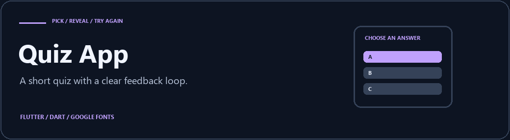

<div align="center">



# Quiz App

**A short quiz with a clear feedback loop.**


[Overview](#overview) &nbsp; · &nbsp; [Run locally](#run-locally) &nbsp; · &nbsp; [Explore the repository](https://github.com/mcampo0215/quiz_app)

</div>

---

## Overview

A Flutter multiple-choice quiz with a start screen, shuffled answer options, and a results summary. Players move through a local question list, compare their selections with the configured answer key, and restart for another round.

| Play | Review | Restart |
| :--- | :--- | :--- |
| Answer six bundled questions, one screen at a time. | See the score and a question-by-question answer summary. | Clear the previous selections and begin a fresh round. |

## Run locally

Use Flutter with Dart compatible with `^3.10.4`, then:

```sh
flutter pub get
flutter devices
flutter run
```

## Customize the quiz

| Source | Responsibility |
| :--- | :--- |
| [lib/data/questions.dart](lib/data/questions.dart) | Bundled prompts and answer options. |
| [lib/models/quiz_question.dart](lib/models/quiz_question.dart) | Question model and shuffled option copies. |
| [lib/quiz.dart](lib/quiz.dart) | Screen transitions, selected answers, and restart. |
| [lib/questions_screen.dart](lib/questions_screen.dart) | Question progression. |
| [lib/results_screen.dart](lib/results_screen.dart) | Score and review summary. |

The scoring code treats the **first answer in each stored answer list** as correct, then shuffles a copy for display. Review the bundled answer keys before using this as a factual trivia quiz: several first choices do not match their questions, and adjacent strings in the bear question are concatenated. The animation illustrates the selection flow; it is not a claim about quiz accuracy.

Answers and progress are kept in memory. There is no account service, online question API, or persistent leaderboard.

## Development

```sh
flutter analyze
flutter test
```

---

<p align="center"><a href="#quiz-app">Back to the top</a></p>
